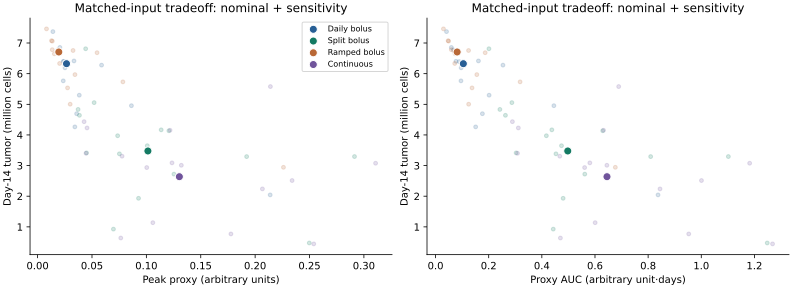

# CAR-T: tumor control and activation tradeoffs

Motivated by my 2023 CAR-T review, coauthored with Ryan Owchar: **can controlled engagement preserve tumor killing while reducing inflammatory activation?**

The model isolates recognition and exposure changes under controlled assumptions. Its purpose is to test whether binding/exposure dynamics can account for the tradeoff, and identify measurements that could change a comparison. Reproducing a concern already encoded in the equations does not independently confirm it.

Two experiments keep their biological architectures separate:

- **CD19/CD22:** single-target, idealized OR/AND recognition, receptor proofreading, effector/memory dynamics and antigen escape.
- **FITC-folate/folate receptor:** adapter binding and a modest PK/PD layer compare bolus, split, ramped and continuous exposure at equal total input and free-adapter AUC.

## Equation origins and evidence

The reference population equations come from [Barros et al. (2021)](https://doi.org/10.3390/cancers13122941). The extensions adapt those terms and introduce explicit response assumptions. Adapter equations are derived from a stated mass-action scheme; [Lee et al. (2019)](https://doi.org/10.1038/s41467-019-10565-7) supplies affinities and experimental motivation, not these coupled equations. [Equation provenance and derivations](MODEL.md#equation-provenance) distinguish each component.

**The extensions are illustrative and uncalibrated.** The present contribution is a reproducible comparison framework, not new biological rate laws or established treatment guidance.

## Conditional results

From one million initial tumor cells, day-30 burdens are **12.29 million (CD19), 12.97 (CD22), 1.11 (OR) and 22.12 (AND)**. OR reaches 0.072 million before double-negative escape drives regrowth.

The separate, exposure-matched adapter experiment gives:

| Schedule | Day-14 tumor, million cells | Peak activation proxy, arbitrary units |
|---|---:|---:|
| No adapter | 7.62 | 0 |
| Daily bolus | 6.33 | 0.0266 |
| Split bolus | 3.48 | 0.1014 |
| Ramped bolus | 6.71 | 0.0195 |
| Continuous | 2.64 | 0.1303 |

This nominal comparison shows a tradeoff, rather than reproducing the paper's reported potency/toxicity co-improvement. It does not reject the mechanism: experimental and simulated inputs are not yet matched. Paired sensitivity scenarios retain all draws and vary unknown residence times at fixed affinities.



## Evidence needed for experimental use

The acceptance target is a simultaneous account of paired killing/cytokine measurements, followed by prediction of withheld conditions. Lee's in-vitro readouts are a candidate anchor, subject to usable measurements and matching assay metadata. Fits must use an identifiable parameter subset; digitized means cannot substitute for raw replicates. Failed predictions could challenge the mechanism or observation model without proving a unique cause. This validation remains unperformed.

## Run and inspect

Python 3.11; from the repository root:

```bash
python -m pip install -e 'projects/modeling/cart_cell[notebook]'
python -m unittest discover -s tests/modeling/cart_cell -v
python projects/modeling/cart_cell/scripts/execute_notebook.py --output-dir artifacts/cart_cell
```

[Executed notebook](CAR_T_Tradeoffs.ipynb) · [Equations and checks](MODEL.md) · [Sources](src/cart_dynamics/data/sources.json) · [Recognition results](results/cart_results.json) · [Exposure results](results/pkpd_results.json)

Analytical controls, independent solvers and receptor/tumor/exposure accounting are tested; CI executes only this study. Records include inputs, seeds, source hashes, residuals and runtime. Normal B cells, host cytokine feedback and exhaustion are absent. The activation proxy is not clinical CRS, and no patient regimen is recommended.
